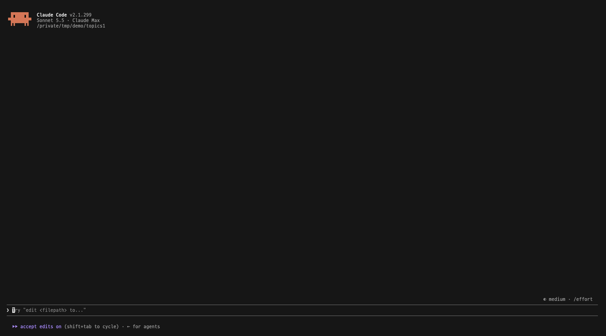
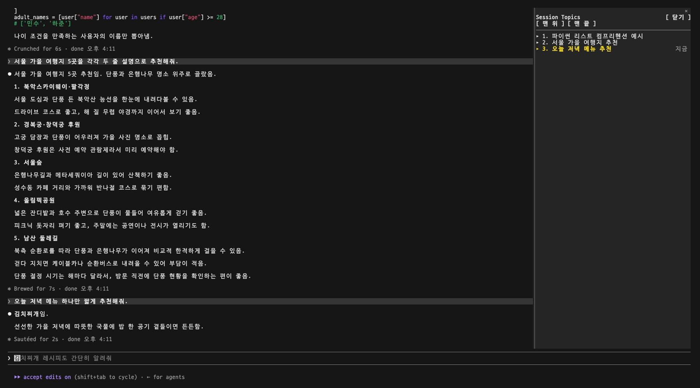
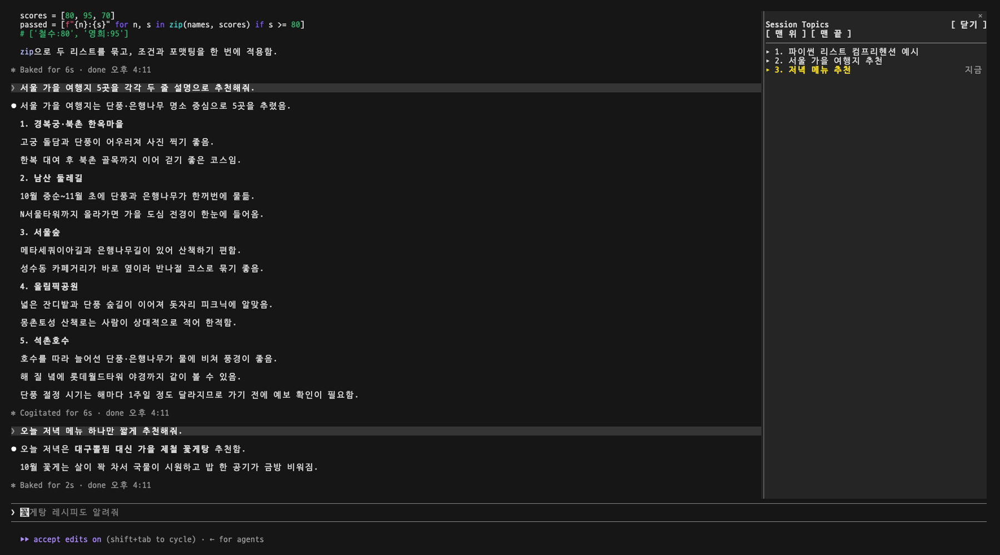
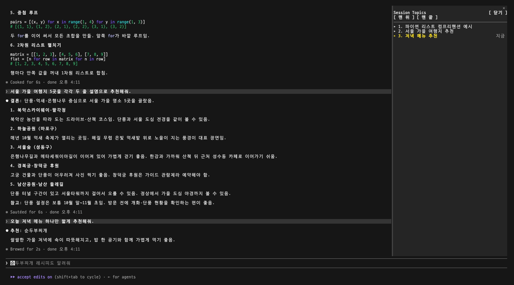

# Session Topics

<p align="center">
  <a href="./README.md"></a>
  <a href="./README.ko.md"></a>
</p>

[Claude Code](https://code.claude.com) 세션에서 나눈 이야기를 주제별로 순서대로 옆 패널에 보여주는 플러그인입니다. 주제마다 한 줄 요약이 붙고, 버튼 하나로 그 주제가 시작된 곳으로 돌아갑니다.



## 목차

- [만든 이유](#만든-이유)
- [1. 설치](#1-설치)
- [2. 설치 후](#2-설치-후)
- [3. 패널에서 할 수 있는 것](#3-패널에서-할-수-있는-것)
- [4. 주제가 만들어지는 방식](#4-주제가-만들어지는-방식)
- [5. 패널 끄고 켜기](#5-패널-끄고-켜기)
- [참고](#참고)

## 만든 이유

Claude Code 세션이 길어지면 여러 이야기를 하게 됩니다. 앞에서 무슨 이야기를 했고 무엇을 정했는지 다시 확인해야 하는데, 대화가 길어지면 위로 밀려 올라가서 찾을 수가 없게 됩니다.

Session Topics는 세션의 주제를 대화 옆 패널에 두고, 누르면 그 주제로 바로 데려갑니다.

## 1. 설치

Claude Code 입력창에 입력합니다.

```
/plugin install session-topics --marketplace selvr0/session-topics
```

1. `Add marketplace?`가 나오면 `y`를 누릅니다.
2. 범위를 고릅니다. 보통 `user`(모든 프로젝트)를 씁니다.
3. `Installed session-topics. Plugin is now active.`가 나오면 끝입니다.

## 2. 설치 후

패널을 엽니다.

```
/session-topics
```

**오른쪽에 붙이려면** Claude Code를 전체 화면 레이아웃으로 써야 합니다. 아니면 입력창 위에 뜹니다.

```
/tui fullscreen
```

**한국어로 보려면** `/config`에서 `session-topics`을 찾아 `language`를 `ko`로 바꿉니다. 기본은 영어입니다.

이미 대화가 있는 세션에서 패널을 열면 몇 초 뒤 그 대화의 주제가 뜹니다. 새 세션이면 Claude의 첫 답이 끝난 뒤 생깁니다.

## 3. 패널에서 할 수 있는 것

```
Session Topics                              [ 닫기 ]
[ 맨 위 ] [ 맨 끝 ]
──────────────────────────────────────────────
▸ 1. 순서를 띄울 방법 찾기
▾ 2. 패널을 둘 수 있는 자리
   ╭──────────────────────────────────────╮
   │ 오른쪽 자리는 하나라 여러 패널은     │
   │ 탭으로 겹침. 왼쪽은 없음             │
   ╰──────────────────────────────────────╯
   [ 이동 ]
▸ 3. 순서를 세션별로 저장              지금
```

| 하고 싶은 것 | 방법 |
|---|---|
| 그 주제에서 정한 것 보기 | 제목을 누름 |
| 그 주제가 시작된 곳으로 가기 | 제목을 누르고 `[ 이동 ]` |
| 대화 처음이나 끝으로 가기 | `[ 맨 위 ]` / `[ 맨 끝 ]` |
| 패널 닫기 | `[ 닫기 ]` |
| 다시 열기 | `/session-topics` |

지금 이야기 중인 주제는 강조되고 `지금`이 붙습니다.

요약 보기:



주제로 돌아가기:



맨 위와 맨 끝:



## 4. 주제가 만들어지는 방식

주제는 사람도 Claude도 적지 않습니다. 플러그인이 만듭니다.

- 주제가 없는 채로 패널을 열 때와 Claude 답이 끝날 때마다 플러그인이 지금까지 대화(내 메시지와 Claude 답, 각각 앞 600자, 최근 400개까지)를 Claude Haiku에 넘기고, 주제별로 나눠 한 줄씩 요약해 달라고 합니다.
- Haiku는 Claude Code 자체 연결과 계정으로 부릅니다. API 키가 필요 없습니다. 사용량에 같이 잡히고, 보통 답 한 번에 비하면 작습니다.
- 답이 끝난 뒤 따로 돌아서 입력을 기다리게 하지 않습니다.
- `[ 이동 ]`은 세션 대화 기록 파일에서 그 주제를 연 메시지를 찾습니다. 그래서 오래된 메시지로도 갑니다.

주제는 세션마다 따로, 플러그인 저장소에 둡니다.

## 5. 패널 끄고 켜기

| 하고 싶은 것 | 입력 |
|---|---|
| 패널 끄기 | `/plugin disable session-topics@session-topics` |
| 다시 켜기 | `/plugin enable session-topics@session-topics` |
| 지우기 | `/plugin uninstall session-topics@session-topics` |

그다음 `/reload-plugins`를 치거나 새 세션을 엽니다.

## 참고

- Claude Code mod(함수 훅) 위에서 돕니다. mod는 아직 얼리 액세스라, Claude Code 업데이트 뒤 패널이 고쳐질 때까지 안 될 수 있습니다.
- 주제를 만들려고 대화 내용을 내 계정의 Haiku에 보냅니다. 다른 곳으로는 가지 않습니다.

## 개발

```
claude plugin validate .
```

## 라이선스

[MIT](./LICENSE)
