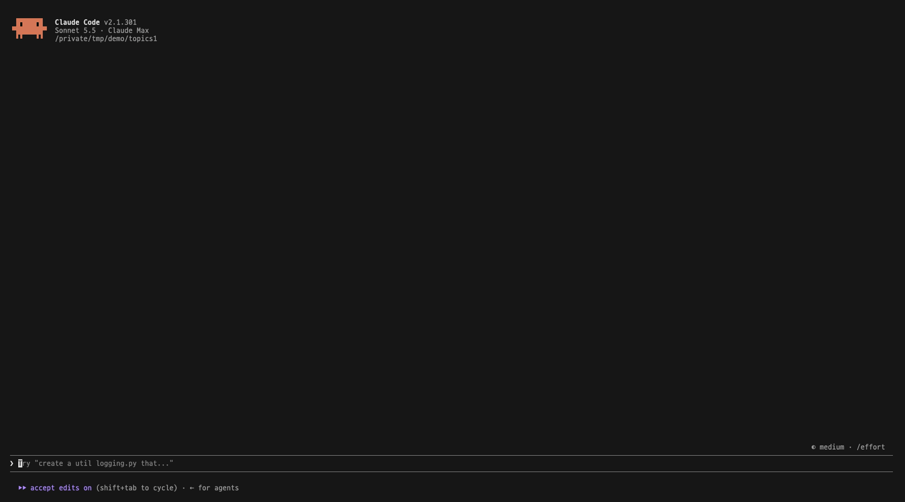
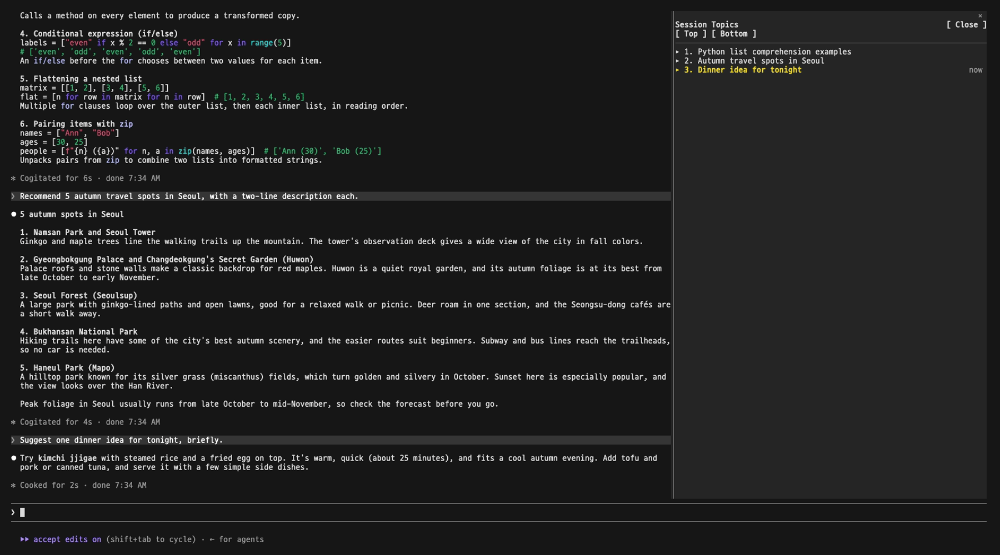
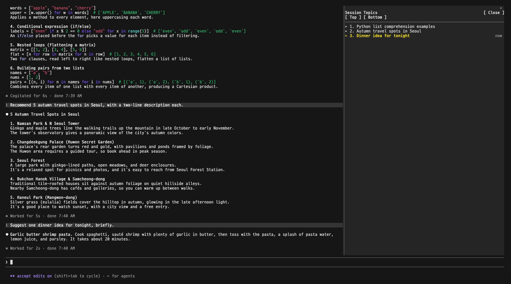
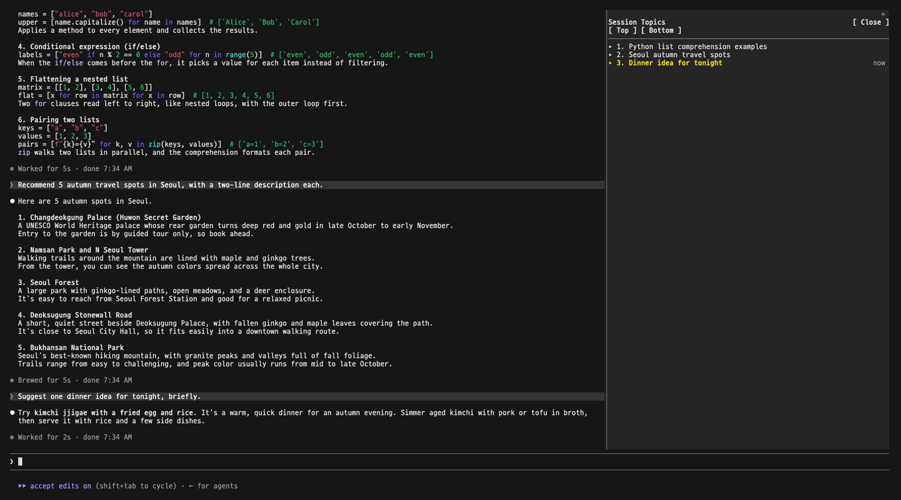

# Session Topics

<p align="center">
  <a href="./README.md"></a>
  <a href="./README.ko.md"></a>
</p>

A side panel for [Claude Code](https://code.claude.com) that lists what you talked about in this session, topic by topic and in order, with a one-line summary of each and a button that jumps back to where it started.



## Contents

- [Why we built this](#why-we-built-this)
- [1. Install](#1-install)
- [2. After installing](#2-after-installing)
- [3. What you can do in the panel](#3-what-you-can-do-in-the-panel)
- [4. How topics are made](#4-how-topics-are-made)
- [5. Turn the panel off or on](#5-turn-the-panel-off-or-on)
- [Notes](#notes)

## Why we built this

A long Claude Code session covers many things. You need to look back at what you already discussed and decided, but as the conversation grows it scrolls out of sight, and you can no longer find it.

Session Topics keeps the session's topics in a panel beside the conversation, and takes you back to any of them with one click.

## 1. Install

Type this at the Claude Code prompt:

```
/plugin install session-topics --marketplace selvr0/session-topics
```

1. `Add marketplace?` appears. Press `y`.
2. Choose the scope. `user` (all your projects) is the usual choice.
3. `Installed session-topics. Plugin is now active.` appears.

## 2. After installing

Open the panel:

```
/session-topics
```

**To dock it on the right**, Claude Code needs its fullscreen layout. Without it, the panel shows above the prompt instead.

```
/tui fullscreen
```

**To see the panel in Korean**, open `/config`, find `session-topics`, and set `language` to `ko`.

When you open the panel in a session that already has a conversation, topics for it appear in a few seconds. In a new session, the first topic appears after Claude's first reply.

## 3. What you can do in the panel

```
Session Topics                              [ Close ]
[ Top ] [ Bottom ]
──────────────────────────────────────────────
▸ 1. Find a way to pin the plan
▾ 2. Where panels can go
   ╭──────────────────────────────────────╮
   │ One slot on the right; panels share  │
   │ it as tabs. No left side.            │
   ╰──────────────────────────────────────╯
   [ Jump ]
▸ 3. Store the plan per session        now
```

| You want to | Do this |
|---|---|
| Read what was decided in a topic | Click its title |
| Go back to where a topic started | Click its title, then `[ Jump ]` |
| Go to the start or end of the conversation | `[ Top ]` / `[ Bottom ]` |
| Close the panel | `[ Close ]` |
| Open it again | `/session-topics` |

The topic you are on now is highlighted and marked `now`.

Read a summary:



Jump back to a topic:



Top and bottom:



## 4. How topics are made

You do not write topics, and neither does Claude. The plugin makes them.

- When you open the panel with no topics yet, and after each Claude reply, the plugin sends the conversation so far (your messages and Claude's replies, the first 600 characters of each, the latest 400 at most) to Claude Haiku, and asks it to split the conversation into topics with a one-line summary each.
- Haiku is called through Claude Code's own connection and account. No API key is needed. It counts toward your usage, and is small next to a normal reply.
- The call runs after the reply, so it never makes you wait to type.
- `[ Jump ]` finds the message that started the topic in the session's transcript file, so it works for old messages too.

Each session keeps its own topics, in the plugin's own storage.

## 5. Turn the panel off or on

| You want to | Type |
|---|---|
| Turn the panel off | `/plugin disable session-topics@session-topics` |
| Turn it back on | `/plugin enable session-topics@session-topics` |
| Remove it | `/plugin uninstall session-topics@session-topics` |

Run `/reload-plugins` afterwards, or start a new session.

## Notes

- Built on Claude Code mods (function hooks), which are in early access. A Claude Code update may break the panel until it is updated.
- Your conversation text is sent to Haiku on your own account to make the topics. It does not go anywhere else.

## Development

```
claude plugin validate .
```

## License

[MIT](./LICENSE)
